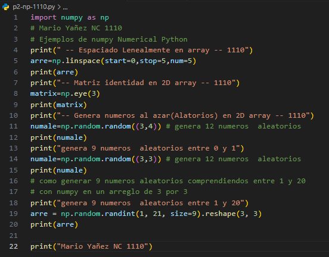
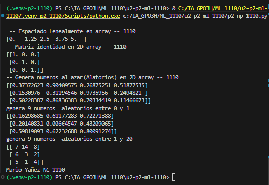

start=0: Indica el valor inicial de la secuencia. En este caso, comienza en 0.

stop=1: Indica el valor final de la secuencia. En este caso, termina en 1.

num=5: Indica la cantidad de valores que se van a generar. En este caso, genera 5 valores igualmente espaciados entre 0 y 1.

## Que es np.linspace
 np.linspace En pocas palabras: np.linspace() genera una cantidad específica de números distribuidos uniformemente entre dos valores.

 ## El codigo 

 ## resultado
 